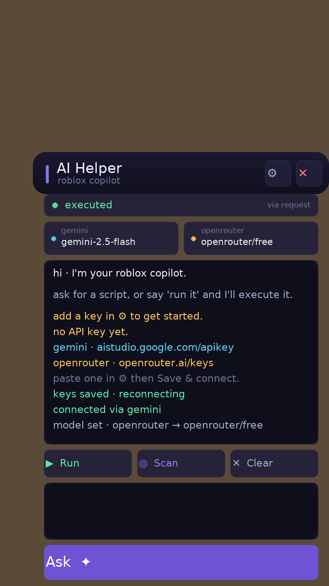

# AI Helper — Roblox executor script

A single-file Luau script that puts a small AI copilot panel inside Roblox
(Delta / mobile friendly). Ask for a script, it fetches it from an LLM provider,
and can run it for you.



```
ai.lua   ← the whole thing, one file, paste into your executor
```

---

## v4 — live model lists (this is what fixed "no provider answered")

OpenRouter keeps pulling models out of its free tier (`HTTP 404 … this model is
unavailable for free`). The old version hardcoded three `:free` slugs, so when
those were retired every request failed.

v4 asks the provider what is available **right now**:

* `GET https://openrouter.ai/api/v1/models` → keeps only models where
  `pricing.prompt == 0` **and** `pricing.completion == 0` and the output
  modality includes text (that's 20–30 models on a typical day).
* `GET /v1beta/models` (Gemini) → keeps only models that support
  `generateContent`, so retired ids can't break it either.
* Tap the **gemini** or **openrouter** chip to open the live list and pick a
  model. Your pick is remembered, and the choice shows on the chip.
* If you never pick, it walks the list until one answers, ending with
  `openrouter/free`.
* If a list can't be fetched (offline, bad key), the picker falls back to a
  built-in shortlist and shows the reason plus a retry button.
* A failed attempt now ends with **one line per provider** (`openrouter: HTTP
  404 … | gemini: 429 …`) instead of a wall of JSON.

## Look and feel

* Compact: 296–356 px wide, up to 52 % … 74 % of the screen height, always
  clamped on-screen, and it shrinks its blocks on short/landscape screens.
* Deep indigo card surfaces with a violet→pink accent, rounded chips, hairline
  strokes, hover/press feedback on every button, and a small status dot
  (green = online, amber = working, red = problem).
* Type: Gotham for prose, Code for the log, with a real hierarchy
  (title 14 · body 10–12 · meta 8–9) instead of one flat size.
* Drag the title bar to move the window, drag the ✦ bubble to move the launcher
  (a drag never counts as a tap).

## Install

1. Open your executor (Delta, Wave, Codex, …) in Roblox.
2. Paste the entire contents of `ai.lua` and execute it.
3. Tap the **✦** bubble to open the panel.
4. Tap **⚙**, paste a key, **Save & connect** — the model lists load by
   themselves.

Free keys:

* Gemini — <https://aistudio.google.com/apikey> (`AQ.…` keys are current and
  supported; they are sent in the `x-goog-api-key` header, which is the only
  way new keys work)
* OpenRouter — <https://openrouter.ai/keys>

Keys are stored on your device (`ai_helper_keys.json`, git-ignored) — never in
this repo. GitHub push protection rejects live keys, correctly.

## Using it

| Element | What it does |
|---|---|
| ⚙ | API keys + "Refresh model lists" |
| gemini / openrouter chip | Opens the live model picker |
| ◎ Scan | Reads the current place (place id, tools, NPCs, remotes) and attaches it to prompts |
| Ask | Sends the prompt (multi-line, no length limit) |
| ▶ Run | Appears when the answer contains a script — executes it |
| ✕ Clear | Clears the log and the conversation memory |
| title bar | Drag to move the window |

Say **"run it"**, **"run now"** or **"execute it"** and it auto-executes the
generated script.

## Providers (in order, automatic fallback)

1. **TokenHarbor** — OpenAI-compatible `/chat/completions` (optional)
2. **Gemini** — `generateContent`, live model list
3. **OpenRouter** — live list of currently-free models

## Notes and limits

* Needs an executor with an HTTP function (`request`, `http_request`,
  `syn.request`, …). Delta's `request` is picked up automatically and the panel
  shows which one it found.
* `loadstring` must be available to run generated code.
* Free tiers are rate limited (OpenRouter free ≈ 20 req/min); expect occasional
  429s.
* Client-side only — it does what the client can do.
* Only run generated code you understand: it executes with your executor's
  privileges.

---

## Bug history

### v3 → v4

| Symptom | Cause | Fix |
|---|---|---|
| `no provider answered · HTTP 404 (meta-llama/llama-3.3-70b-instruct:free)` | hardcoded `:free` slugs were retired by OpenRouter | fetch `/api/v1/models`, filter `pricing == 0`, auto-fall-back down the live list |
| Gemini `2.5-flash-lite` failing | retired/unauthorised model id | fetch `/v1beta/models`, keep only `generateContent` models, pick from the list |
| failure output was a wall of JSON | error bodies were logged raw | one-line summary per provider |
| font too small, flat look | single text size, flat fills | type hierarchy, gradient surfaces, chips, hover states |

### Why it "did nothing" when you executed it (v1 → v2)

The v1 script **never ran a single line**. Here is what was broken, in order of
severity:

| # | Bug | Effect |
|---|-----|--------|
| 1 | `goto done` / `::done::` in `AskAI` (lines 246–271) | **Luau has no `goto`.** The file failed to *compile*, so nothing appeared, no errors you could see, no panel — just silence. This alone explains "I execute it and it doesn't work". |
| 2 | `typeof(request)` / `http and http.request` | `http` and `syn` are not globals in Luau, so touching them raised *"attempt to index a nil value"*. Replaced with `pcall`-protected `_G` lookups. |
| 3 | `InputBox.MultiLine = true` + `FocusLost` to submit | On mobile keyboards `FocusLost` usually never fires, so pressing send did nothing. The **⚡ ASK** button is now the send path. |
| 4 | `ExtractCode` required `"\n```"` exactly | Any reply using CRLF, ` ```luau `, or a fence without a blank line produced `nil` → "no code found" → no Run button. |
| 5 | `workspace:GetDescendants()` over the whole map, synchronously | On real games this freezes the client for seconds (looks like a crash). Now a bounded breadth-first walk. |
| 6 | HTTP calls with no timeout | A bad key/URL left it stuck on "thinking…" forever. |
| 7 | `game.CoreGui` assumed writable | Crashes the script if the executor blocks CoreGui. Now falls back to `PlayerGui`. |
| 8 | Gemini key was an `AQ.Ab8…` browser token | Not accepted by `generateContent` — Gemini always 400'd. The script now says so clearly instead of a silent fallback. |
| 9 | Generated code ran on the main thread with `pcall(fn)` | A `while true do` in generated code froze the whole panel. Now spawned on its own thread; runtime errors are reported back into the log. |
| 10 | Everything was in the global scope | Re-running the script collided with leftovers. Now wrapped in a `do ... end` block. |

The complete v2 file passes a headless simulation of the Roblox API
(boot → provider fallback → scan → ask → code extraction → auto-exec) plus unit
tests for the fence parser.

---

## Install

1. Open your executor (Delta, Wave, Codex, …) in Roblox.
2. Paste the entire contents of `ai.lua` and execute it.
3. Tap the **🤖** bubble (left edge) to open the panel.
4. **Add your API key** — the ⚙ panel opens by itself on first run. Paste your
   Gemini key (from <https://aistudio.google.com/apikey>) into the first box,
   tap **💾 Save & reconnect**, done. It is reused next session when your
   executor supports `writefile`.

### Where are the keys?

Not in this repo. A live API key in a public repo is a leak — GitHub's push
protection rejects the push outright, which is what happened here. The script
ships with empty keys and keeps whatever you enter in the ⚙ panel
(`ai_helper_keys.json`, git-ignored). If you prefer to keep the key in the file
itself, put it in `CONFIG.gemini.key` **in your own copy** and don't commit it.

> Re-running the script is safe: it destroys the previous GUI first.

## Using it

| Element | What it does |
|---|---|
| ⚙ | Paste / replace API keys, then **Save & reconnect** |
| gemini: picker | Choose which Gemini model the fallback uses |
| title bar | drag to move the window |
| 🔍 Scan | Reads the current place (place id, tools, NPCs, remotes) and attaches it to every prompt |
| ⚡ ASK | Sends your prompt (no length limit, multi-line works) |
| ▶ Run | Appears when the answer contains a script — executes it |
| 🗑 Clear | Clears the log and the conversation memory |

Say **"run it"**, **"run now"**, **"execute it"** in your prompt and it
auto-executes the generated script.

## Providers

Tried in order, automatic fallback:

1. **TokenHarbor** — `POST https://api.tokenharbor.ai/v1/chat/completions` (OpenAI-compatible)
2. **Google Gemini** — `generateContent`, model chosen in the picker
3. **OpenRouter** — free models, tried in sequence if a model id disappears

If one provider fails you'll see exactly why in the log, e.g.
`⚠ gemini: HTTP 400: API key not valid`, then it moves on.

### About the keys

The keys currently baked into `ai.lua` are the ones from the original file.
Two of them are not usable, so expect the panel to come up on **OpenRouter**
or not at all:

* `GEMINI_KEY` is an `AQ.…` key — that is the **current** Google format, and it
  works, but only when sent in the `x-goog-api-key` header (v3 does that).
* `TOKENHARBOR_KEY` is a bearer token in the original file; if the service
  rejects it, the chain simply skips it and moves to Gemini.

Get free keys here:

* Gemini — <https://aistudio.google.com/apikey>
* OpenRouter — <https://openrouter.ai/keys>

Paste them in the ⚙ panel (no need to edit the file) — they are kept for the
session and, if your executor exposes `writefile`, saved to
`ai_helper_keys.json` in the executor's workspace folder.

> The keys that were in the shared file are now public — rotate them.

## Notes and limits

* Needs an executor with an HTTP function (`request` / `http_request` /
  `syn.request`). Delta has `request`.
* `loadstring` must be available to run generated code (every mainstream
  executor has it).
* This is a client-side script: it can only do what the client can do.
  Server-side exploits are out of scope.
* Only run generated code if you understand it — it executes with your
  executor's privileges.
